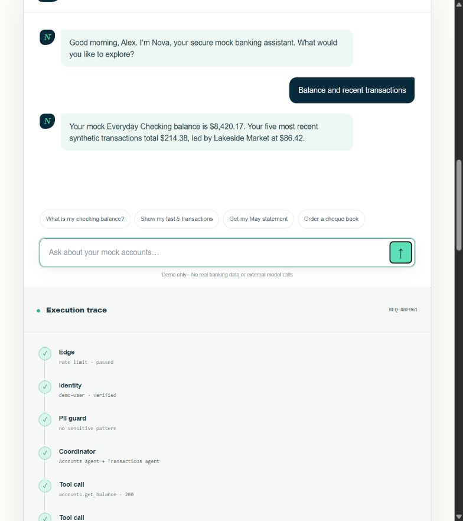
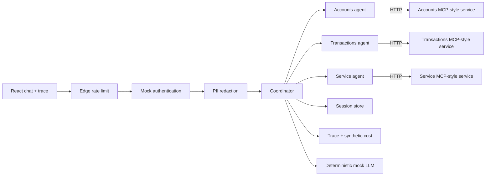

# Aegis Bank AI

> A secure, mock-first multi-agent banking assistant reference implementation.



[Architecture evolution](docs/ARCHITECTURE_EVOLUTION.md) · [Security model](docs/SECURITY.md) · [API contract](docs/API.md) · [5-minute demo](docs/DEMO.md)

## Why this project exists

Most chatbot demos hide the interesting engineering. Aegis makes it visible. A request passes through an edge limit, mock identity, authorization policy, PII redaction, deterministic coordination, one or more domain agents, and isolated MCP-style HTTP services. The UI shows that trace beside every answer.

The boundaries and connection code are real. The customers, accounts, transactions, identity, tools, model responses and cost figures are synthetic. Nothing connects to a bank or external model by default.

## System at a glance



## What is real and what is mocked

| Concern | Implemented for real | Intentionally mocked |
|---|---|---|
| Web experience | Responsive React UI, keyboard-accessible chat and architecture viewer | Customer identity and displayed values |
| Orchestration | Typed plans, concurrent multi-agent execution, policies and error boundaries | Natural-language generation |
| Integration | `httpx` calls, service URLs, timeouts, headers, typed request/response bodies | The three local data providers |
| Security | Auth dependency, scopes, redaction, rate-limit boundary | Identity provider, WAF and production secrets |
| Operations | Correlation IDs, per-stage traces and calculated mock cost | Telemetry backend and billing |

## Repository layout

```text
app/                 Interactive React/TypeScript portfolio experience
backend/app/         FastAPI gateway, coordinator, agents and guardrails
backend/services/    Three isolated MCP-style synthetic banking services
backend/tests/       Unit and orchestration tests
architecture/        One concise design note for every step from 01–14
docs/                Architecture, security, API and interview demo guides
evals/               Seven routing, tool-use and safety evaluation cases
scripts/             Local multi-service launcher
.github/workflows/   Frontend, backend and evaluation CI
```

## Run locally

Prerequisites: Node.js 22+, Python 3.11+.

```powershell
npm install
python -m venv .venv
./.venv/Scripts/python.exe -m pip install -r backend/requirements.txt
./scripts/run-local.ps1
```

Open `http://localhost:3000`. The launcher starts the coordinator on port `8000` and the mock services on ports `8101`–`8103`.

Run verification separately:

```powershell
npm run build
python -m pytest backend/tests
python evals/evaluate.py
```

## Safe demo prompts

- `What is my checking balance?`
- `Show my last 5 transactions`
- `Get my May statement`
- `Order a cheque book`
- `Change my address`
- `Balance and recent transactions`
- `My card is 4111 1111 1111 1111`

That card number is a standard non-production test value. The project redacts it before routing and calls no banking tool.

## Safety contract

- Mock mode is explicit in responses and service headers.
- The only accepted identity token is `Bearer mock-demo-token`.
- External model access is disabled and unnecessary.
- Write-like actions are simulations; cheque books are not mailed and address changes are not committed.
- The project contains no real customer data, bank endpoint or production credential.

## Interview story

Start with the UI, run the multi-agent prompt, then run the PII test. Explain that the architecture did not begin with fourteen boxes: each step addresses a concrete limitation in the previous design. Finish with the evaluation suite and the “real boundaries / mock data” table. See [the five-minute script](docs/DEMO.md).

## Disclaimer

For education and portfolio demonstration only. Aegis Bank AI is not a bank, does not provide financial advice, and must not be connected to production financial systems without a full security, privacy, compliance and operational review.
