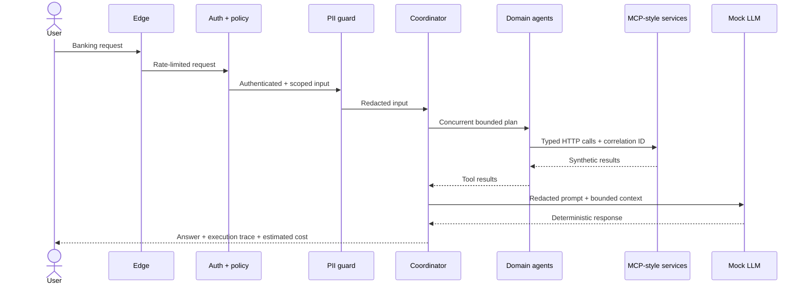

# Architecture evolution: steps 1–14

The system grows in response to risk and complexity. Steps 7, 9 and 11 are marked as inferred bridge steps because the original reference set did not include corresponding screenshots.

| Step | Addition | Why it is added | New trade-off |
|---:|---|---|---|
| 1 | Simple demo | Prove chat → API → agent → model flow. | One agent quickly becomes overloaded. |
| 2 | Bank APIs as tools | Replace free-form answers with typed capabilities. | Tool selection and failures need governance. |
| 3 | Domain agents | Give Accounts, Transactions and Service bounded ownership. | Cross-domain requests now require orchestration. |
| 4 | Coordinator | Plan and combine one or several agent calls. | A central routing decision becomes critical. |
| 5 | MCP service layer | Isolate tools behind stable HTTP contracts. | More processes and network failure modes appear. |
| 6 | Authentication | Establish the request identity at the boundary. | Identity alone does not grant an action. |
| 7* | Authorization | Apply customer, agent and tool scopes. | Policy definitions require lifecycle management. |
| 8 | Session management | Retain bounded conversation and inter-agent state. | State must be isolated, expired and observable. |
| 9* | LLM abstraction | Keep provider choice behind a replaceable interface. | Provider capabilities and prompts can diverge. |
| 10 | PII redaction | Remove sensitive patterns before model processing. | Detection has false-positive and false-negative risk. |
| 11* | Agent evaluation | Turn routing, safety and tool expectations into tests. | Evals need representative, maintained cases. |
| 12 | Observability | Trace request, agent, tool, latency and outcome. | Telemetry itself needs privacy controls. |
| 13 | Cost tracking | Attribute estimated model and tool cost per request. | Estimates require calibration against real billing. |
| 14 | Edge security | Add rate limiting and document WAF/gateway boundaries. | Production enforcement lives beyond application code. |

`*` Inferred bridge step.

## Final request lifecycle

## Design invariants

1. Data is synthetic at rest and in transit.
2. The redacted input—not the raw prompt—is routed or passed to a model.
3. Agents cannot call tools outside their domain.
4. Tools require an authenticated principal with the right scope.
5. Every cross-service request carries a correlation ID and three-second timeout.
6. Multi-domain reads may run concurrently; write-like service requests remain explicit.
7. The default model adapter is deterministic and network-free.

The concise step notes in [`architecture/`](../architecture/) make the evolution easy to present one slide or commit at a time.
